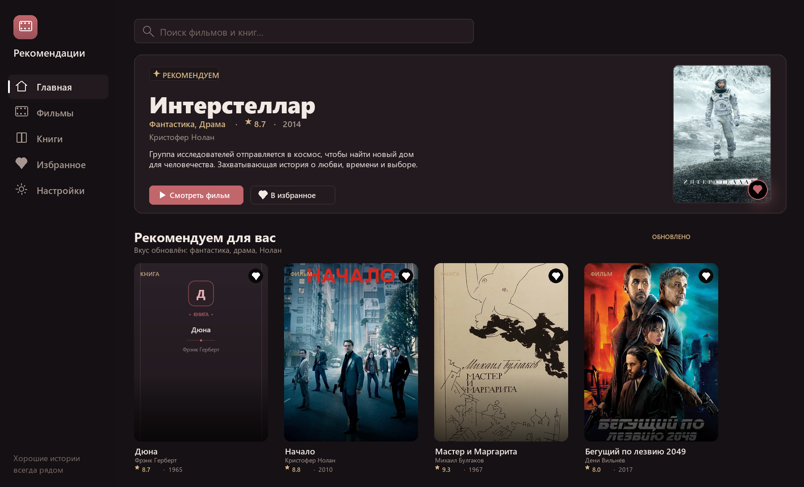
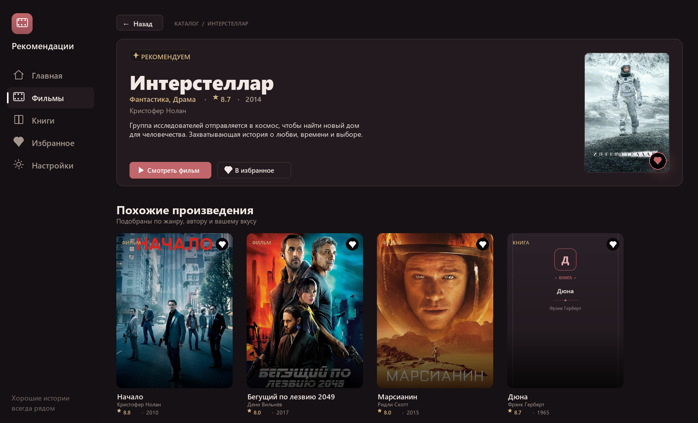
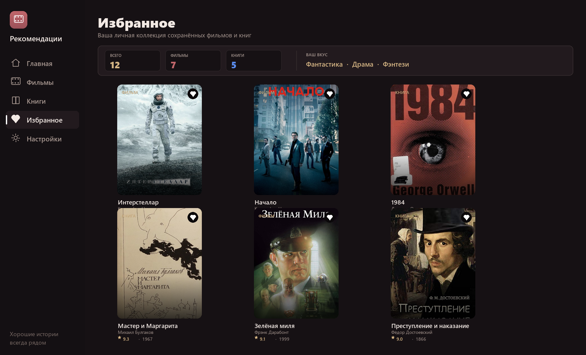
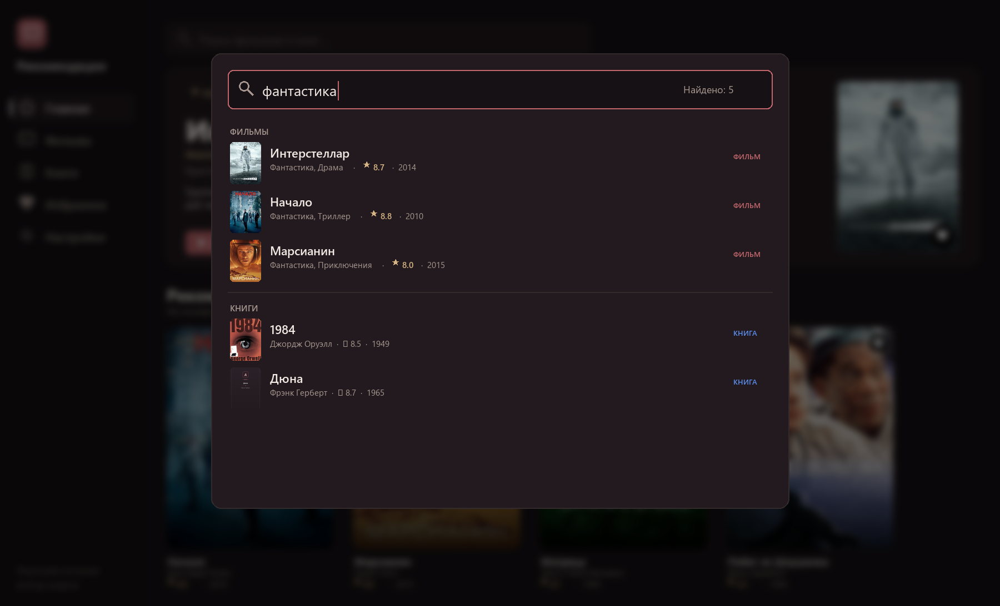

# 🎬 MovieBook Recommender

> **Интеллектуальная персональная система рекомендаций фильмов и книг для Windows (WPF / .NET 6)**

[](https://dotnet.microsoft.com/)
[](https://docs.microsoft.com/dotnet/csharp/)
[](https://learn.microsoft.com/visualstudio/designers/getting-started-with-wpf)
[](https://github.com/Inexc/reccomend)
[](LICENSE)

**MovieBook Recommender** — современное десктопное приложение, объединяющее миры кинематографа и литературы в едином интерфейсе. Программа изучает предпочтения пользователя и предлагает умные персональные рекомендации: от фильмов по мотивам любимых книг до литературных произведений со схожей атмосферой.

---

## 📸 Скриншоты интерфейса

### Главная страница (Hero-баннер и динамические подборки)


### Детальная карточка произведения (метаданные, синопсис и «Похожие истории»)


### Личная коллекция («Избранное», статистика и фильтрация)


### Умный поиск с мгновенным откликом и клавиатурной навигацией


---

## ✨ Ключевые возможности

### 🧠 Интеллектуальный рекомендательный движок
* **Гибридный скоринг:** оценка каждого произведения рассчитывается из взвешенного рейтинга, сходства жанровых векторов и пересечений по авторам/режиссёрам.
* **Нормированный вкусовой профиль:** алгоритм анализирует избранное пользователя и нормирует вклад жанров ($[0..1]$), гарантируя, что даже при десятках сохранённых произведений вкус не перекрывает общий рейтинг мировых шедевров.
* **Разнообразие авторов (Author Diversity):** в выдаче действует ограничение не более 2 произведений одного автора/режиссёра, чтобы лента оставалась разнообразной.
* **Баланс медиа-типов:** гармоничное чередование фильмов и книг в смешанных фидах с учётом стартового рейтинга.
* **Защита от дубликатов:** строгий взаимный учёт исключений между секциями «Рекомендуем для вас», «Популярное» и «Свежее в коллекции».

### 🔍 Полнотекстовый поиск и фильтрация
* **Нормализация и регистронезависимость:** толерантность к регистру, обрезка лишних пробелов и автоматическая замена `ё` $\to$ `е` (поиск «зеленая миля» корректно находит «Зелёная миля»).
* **Поиск по всем словам (AND):** запросы из нескольких слов (например, «нолан интерстеллар» или «толстой роман») ищутся по всей связке метаданных (название, автор, жанры, год).
* **Клавиатурная навигация:** быстрый выпадающий список поддерживает стрелки `↑` / `↓` для циклического выбора, `Enter` для быстрого перехода и `Esc` для закрытия.
* **Дебаунс 120 мс:** плавный набор текста без зависаний UI и мгновенный сброс при очистке поисковой строки.

### ⭐️ Избранное и персонализация
* Компактный аналитический дашборд: статистика общего количества, отдельно фильмов и книг.
* Сегментированная фильтрация («Все», «Фильмы», «Книги») и сортировка по рейтингу, названию и дате.
* Блок персонального добора «На основе вашего избранного» без дублирования уже сохранённого.

### 🎨 Визуальный стиль «Тёплый нуар»
* Глубокая тёмная палитра (`#161114`, `#1F181D`) с акцентами цвета бургунди (`#C1666B`) и тёплого золота (`#D4B483`).
* 60 fps анимации переходов, плавные градиенты постеров и выверенная типографика (Segoe UI Semibold).
* Полная адаптивность: отзывчивая вёрстка для разрешений от 1366×768 до 4K.

### 🌐 100% Автономность + Онлайн-постеры
* **TMDb API:** автоматическая загрузка официальных постеров к фильмам в высоком разрешении.
* **Open Library Covers API:** бесплатная подгрузка обложек книг без необходимости регистрации ключей.
* **Автономный оффлайн-режим:** при отсутствии интернета или ключа приложение не падает, а генерирует стильные процедурные обложки со стабильным хэшированием цветов.

---

## 🚀 Быстрый старт

### Требования
* Операционная система: **Windows 10 / 11**
* **.NET 6.0 SDK** (или выше) с поддержкой Desktop Workload

### 1. Клонирование репозитория
```bash
git clone https://github.com/Inexc/reccomend.git
cd reccomend
```

### 2. Настройка API-ключа (опционально)
Приложение полностью работоспособно «из коробки» в автономном режиме. Если вы хотите видеть оригинальные постеры фильмов из базы The Movie Database:

1. Зарегистрируйтесь на [themoviedb.org](https://www.themoviedb.org/) и получите бесплатный API-ключ v3 в настройках аккаунта.
2. Скопируйте файл шаблона `secrets.example.json` в `Data/secrets.json`:
   ```bash
   cp secrets.example.json Data/secrets.json
   ```
3. Впишите ваш ключ:
   ```json
   {
     "tmdbApiKey": "ВАШ_TMDB_API_КЛЮЧ"
   }
   ```
   *(Также поддерживается переменная окружения `TMDB_API_KEY`).*

### 3. Сборка и запуск
```bash
dotnet restore
dotnet build
dotnet run
```
Или откройте решение `MovieBookRecommender.sln` в **Visual Studio 2022** / **JetBrains Rider** и нажмите `F5`.

---

## 📂 Структура проекта

```text
MovieBookRecommenderCS/
├── Config.cs                     # Конфигурация API, режима онлайн-постеров и логирования
├── MainWindow.xaml (.cs)         # Корневое окно: навигация, переходы страниц, управление темами
├── App.xaml (.cs)                # Точка входа, синглтон-проверка процесса и глобальные ресурсы
├── secrets.example.json          # Шаблон конфигурации секретов
│
├── Models/                       # Доменные модели
│   ├── MediaItem.cs              # Универсальная сущность фильма/книги
│   └── MediaKind.cs              # Перечисление типов (Movie, Book)
│
├── Services/                     # Бизнес-логика приложения
│   ├── RecommendationService.cs  # Центральный алгоритмический движок рекомендаций
│   ├── DataManager.cs            # Загрузка каталога, сериализация и управление избранным
│   └── PosterService.cs          # Загрузка постеров (TMDb, OpenLibrary, генерация заглушек)
│
├── Views/                        # Экраны и визуальные компоненты
│   ├── HomePage.xaml (.cs)       # Главный экран (Hero-баннер, сетка рекомендаций)
│   ├── ListPage.xaml (.cs)       # Каталог фильмов и книг с фильтрами по жанрам
│   ├── DetailPage.xaml (.cs)     # Детальная карточка с похожими произведениями
│   ├── FavoritesPage.xaml (.cs)  # Личная коллекция и аналитика
│   ├── SettingsPage.xaml (.cs)   # Настройки приложения
│   ├── DetailsPanel.xaml (.cs)   # Выдвижная правая панель «Подбор для вас»
│   ├── SidebarControl.xaml (.cs) # Боковое меню навигации
│   └── CardControl.xaml (.cs)    # Карточка произведения с hover-эффектами
│
├── Styles/                       # XAML-темы и стилизация
│   ├── DarkTheme.xaml            # Цветовая палитра «Тёплый нуар» (DynamicResource)
│   ├── Controls.xaml             # Стили кнопок, инпутов, комбобоксов и скроллбаров
│   └── Icons.xaml                # Векторная графика (PathGeometry)
│
├── Data/                         # Локальная база произведений
│   ├── movies.json               # База фильмов (рейтинг, жанры, режиссёр, год, описание)
│   ├── books.json                # База книг (рейтинг, жанры, автор, год, описание)
│   └── secrets.example.json      # Локальный шаблон ключей
│
└── docs/                         # Документация и медиа-материалы
    └── screenshots/              # Скриншоты экранов приложения
```

---

## 🛠 Технологический стек

* **Язык и среда:** C# 10, .NET 6.0 (`net6.0-windows`), Nullable Reference Types.
* **Платформа UI:** WPF (Windows Presentation Foundation) с аппаратным ускорением DirectX.
* **Разметка:** Адаптивный XAML с использованием `DynamicResource`, `UniformGrid`, векторных иконок и `Storyboard` анимаций.
* **Сериализация:** Высокопроизводительный `System.Text.Json`.
* **Внешние API:** The Movie Database (TMDb) v3 API, Open Library API.

---

## 📄 Лицензия

Проект распространяется под лицензией [MIT](LICENSE). Вы можете свободно использовать, модифицировать и распространять данный код.
